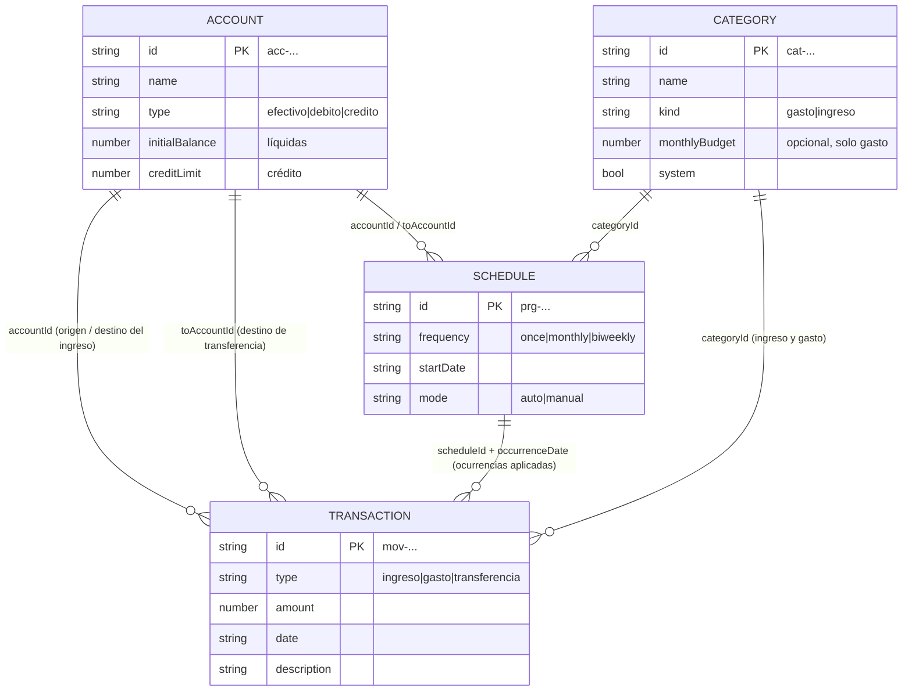
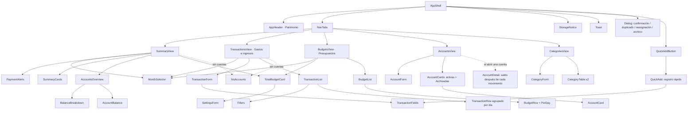
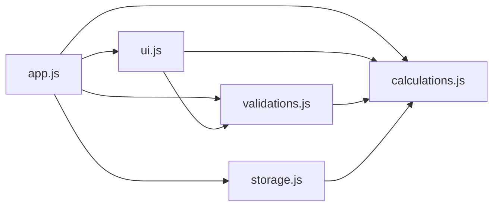
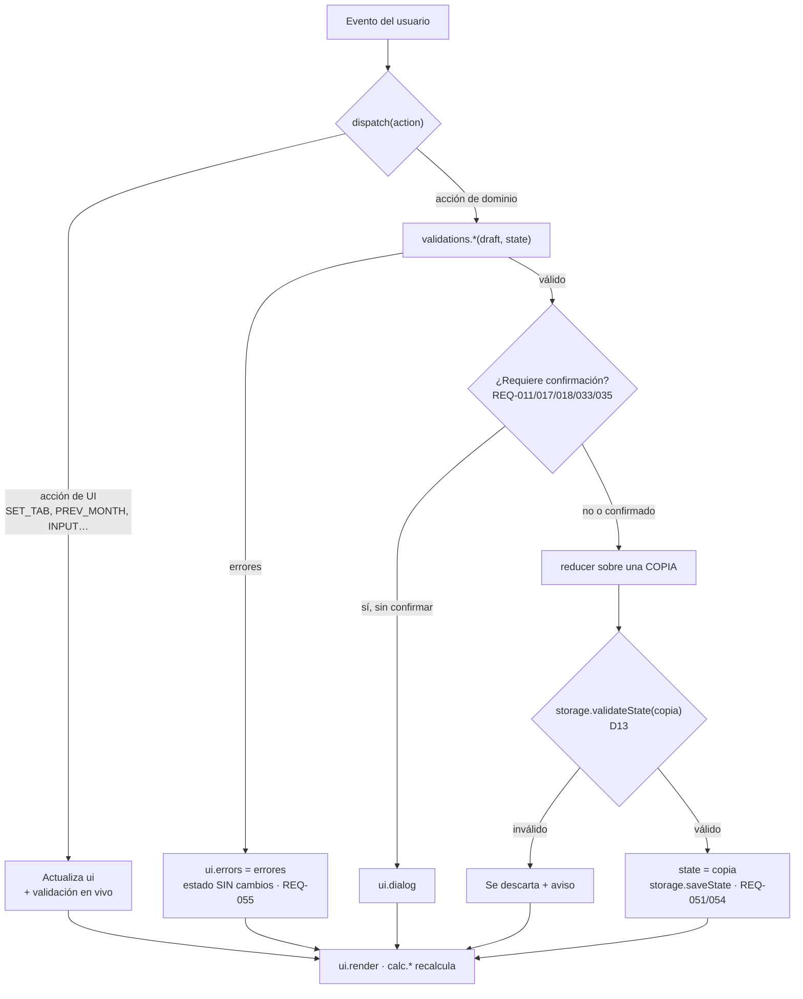
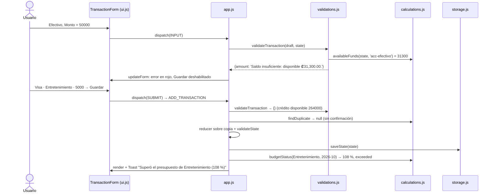
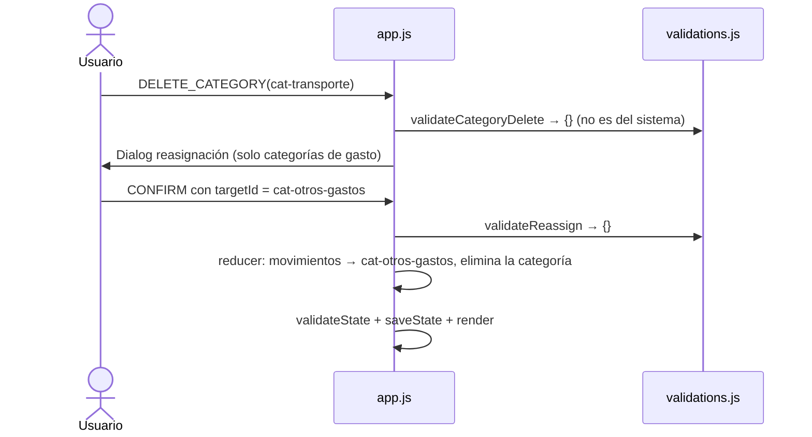
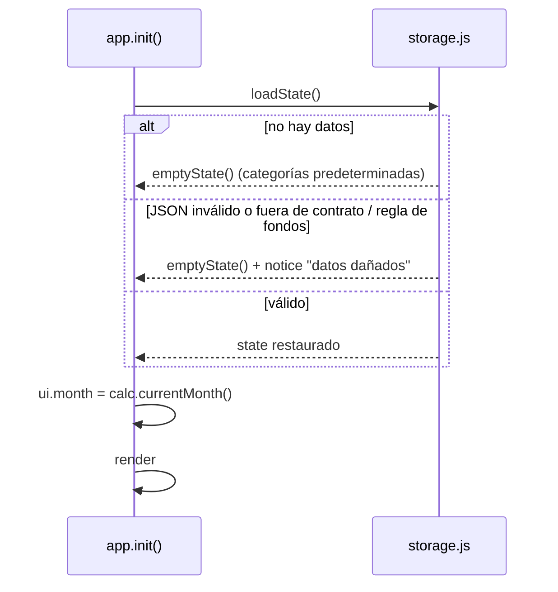

# Documento de Diseño Técnico y Arquitectura — FinanzApp

> Traduce la especificación EARS ([`requirements.md`](./requirements.md)), el contrato de datos
> ([`data-contract.json`](./data-contract.json)) y el wireframe ([`wireframe.md`](./wireframe.md) · [`wireframe.png`](./wireframe.png))
> en componentes, módulos, manejo de estado y flujos de datos. La memoria semántica que guía los nombres está en
> [`../CLAUDE.md`](../CLAUDE.md).
>
> **Estado:** implementado en [`../src/`](../src/) siguiendo [`../tasks.md`](../tasks.md).

**Curso:** Programación Intencional con IA Generativa
**Estudiante:** José Fallas — jfallash@ucenfotec.ac.cr
**Aplicación:** FinanzApp — Finanzas personales
**Versión:** 6 (Octubre 2026) · Especificación v6 · Contrato `schemaVersion: 3` (campos opcionales de meta en cuentas de ahorros)

---

## 1. Visión general, stack y poda arquitectónica

| Aspecto | Decisión |
|---|---|
| Tipo de app | SPA estática de una sola página (`src/index.html`) |
| Stack | HTML + CSS puro escrito a mano + JavaScript vanilla (sin frameworks, librerías, build ni CDN) |
| Estado | **Un objeto de estado en memoria** (`state`) dentro de `app.js` + estado de interfaz (`ui`) no persistido |
| Persistencia | `localStorage`, clave `finanzapp.state`, estado completo en cada mutación (REQ-051) |
| Red | Ninguna. Se bloquea por diseño con Content-Security-Policy (REQ-047) |
| Ejecución | Abrir `src/index.html` con doble clic (`file://`) o publicarla en GitHub Pages (§10) |
| Moneda | Colones (₡), una sola moneda |

**Entidades (requisito: ≥ 2 entidades vinculadas):**



**Poda de sobreingeniería (descartado a propósito):**

| Propuesta típica de la IA | Por qué se descarta | Alternativa ligera adoptada |
|---|---|---|
| React / Vue / Svelte | Viola "sin frameworks"; exige build | Funciones de render en `ui.js` que crean DOM |
| Redux / store reactivo | Un solo usuario y un solo estado | Un `state` + `dispatch(action)` en `app.js` |
| Backend, API REST, base de datos | Viola REQ-047 | `localStorage` |
| IndexedDB / PWA | Más complejidad que valor para este volumen | `localStorage` |
| Guardar el saldo en la cuenta | Se desincroniza con los movimientos (REQ-049) | Saldo **derivado** con `calc.accountBalance` |
| Chart.js para gráficos | Dependencia externa y no está en la especificación | Barras de progreso en CSS |
| Ajv u otro validador de JSON Schema | Dependencia externa | Validador escrito a mano en `storage.validateState` |
| ES Modules (`import`/`export`) | Bloqueados en `file://` | Scripts clásicos con `window.FinanzApp` |
| Movimientos recurrentes, varias monedas, metas | No están en la especificación (REQ-050) | Fuera de alcance |

## 2. Memoria semántica: del lenguaje ubicuo al código

| Entidad (lenguaje ubicuo) | En el contrato | En el código | ¿Persistida? |
|---|---|---|---|
| **Account** | `accounts[]` | `state.accounts` | Sí |
| **Category** | `categories[]` | `state.categories` | Sí |
| **Transaction** | `transactions[]` | `state.transactions` | Sí |
| **AccountBalance** | — | `calc.accountBalance(state, id, excludeTxId?)` | No |
| **AvailableFunds** | — | `calc.availableFunds(state, id, excludeTxId?)` | No |
| **NetWorth** | — | `calc.netWorth(state)` | No |
| **MonthSummary** | — | `calc.monthSummary(state, ym)` | No |
| **BudgetStatus** | — | `calc.budgetStatus(state, categoryId, ym)` | No |
| **DayNet** | — | `calc.dayNet(list)` · `calc.groupByDate(list)` | No |

**Invariantes del dominio que el diseño hace cumplir** (detalle en CLAUDE.md §5):

1. **Saldo protegido (RN-03):** `validations.js` rechaza cualquier alta, edición o borrado que deje una cuenta fuera de la regla, y `storage.validateState` lo vuelve a comprobar antes de guardar (D13).
2. **Persistencia obligatoria:** `dispatch` siempre termina en `storage.saveState(state)`.
3. **Validación estricta:** ninguna acción muta el estado si `validations.*` devuelve errores.

## 3. Reglas de negocio y función responsable

| Regla | Fórmula | Función |
|---|---|---|
| RN-01 | `saldo = initialBalance + ingresos + transf. entrantes − gastos − transf. salientes` | `calc.accountBalance`, `calc.creditDebt`, `calc.availableFunds` |
| RN-02 | `Patrimonio = Σ saldos` | `calc.netWorth` |
| RN-03 | **En todo momento** (orden cronológico): líquida ≥ 0 · crédito: `0 ≥ saldo ≥ −creditLimit` | `calc.timeline`, `calc.availableFunds(…, date)`, `calc.paymentRoom`, `calc.accountViolations`; usado por `validate.validateTransaction/TransactionDelete/Account` y `storage.validateState` |
| RN-04 | Validaciones de borde | `validate.parseAmount`, `validate.validateTransaction/Account/Category` |
| RN-05 | `neto = ingresos − gastos`; `ahorro = neto / ingresos × 100` | `calc.monthSummary` |
| RN-06 | `% = gastado / presupuesto × 100` → `ok` ≤ 80 · `warning` ≤ 100 · `exceeded` > 100 | `calc.budgetStatus`, `calc.statusFromPercent` |
| RN-07 | `Neto del día = Σ ingresos − Σ gastos` | `calc.dayNet`, `calc.groupByDate` |
| RN-08 | Duplicado: tipo, cuenta, monto, fecha, descripción normalizada | `calc.findDuplicate` |
| RN-09 | `Disponible = Σ efectivo + débito`; `Ahorros = Σ ahorros`; `Deudas = Σ deudas`; `Patrimonio = Disponible + Ahorros − Deudas` | `calc.balanceSummary` |
| RN-10 | Último corte = fecha más reciente con `cutoffDay` < hoy; pago = primera fecha con `paymentDay` posterior; `pago del periodo = deuda al corte − pagos posteriores` (≥ 0) | `calc.creditCycle`, `calc.paymentAlerts` |
| RN-11 | `% total = (gastos del mes + apartado a ahorros, RN-13) / settings.monthlyBudget × 100` *(v6)* (mismos umbrales que RN-06); por día: `restante / días restantes del mes` | `calc.totalBudgetStatus`, `calc.remainingDays`, `calc.categoryBudgetsSum` |
| RN-12 *(v4)* | Programación → ocurrencias por frecuencia (una vez · mismo día cada mes o último · días 15 y último). Ocurrencia **abierta** = ni aplicada (movimiento con `scheduleId` + `occurrenceDate`) ni omitida; **programada** si fecha > hoy, **pendiente** si fecha ≤ hoy. Resumen y presupuestos del mes incluyen las abiertas; saldo actual, patrimonio y deudas solo movimientos reales; proyección a fin de mes = reales + abiertas | `calc.scheduleOccurrences`, `openOccurrences`, `dueOccurrences`, `upcomingOccurrences`, `monthItems`, `projectedState`, `projectedBalance`, `projectionAlerts` |
| RN-13 *(v6)* | **Apartado a ahorros** del mes = Σ transferencias del mes hacia cuentas `ahorros` − Σ transferencias del mes desde `ahorros` hacia cuentas de otro tipo, mínimo 0, incluyendo ocurrencias abiertas. **Consumido del presupuesto total** = gastos del mes + apartado. Una transferencia entre dos cuentas de ahorros no cuenta. **Meta**: progreso = saldo actual / meta; aporte mensual = Σ equivalente mensual de programaciones activas que transfieren a la cuenta; meses estimados = ⌈falta / aporte⌉ | `calc.savingsSetAside`, `calc.totalBudgetStatus`, `calc.goalProgress` |

**Ejemplo verificable (dataset oficial, octubre 2026, hoy = 26 oct):** Efectivo en orden cronológico `25,000 − 15,000 + 40,000 − 18,000 + 35,000 − 31,200 − 4,500 = ₡31,300` (nunca negativo); Visa `−68,500 − 27,500 + 60,000 = −₡36,000` → disponible `₡264,000`; corte 15 oct: deuda `₡96,000` − pago `₡60,000` = **pago del periodo `₡36,000`** el 28 oct (2 días); Disponible `₡392,400` + Ahorros `₡250,000` − Deudas `₡36,000` = Patrimonio `₡606,400`; Alimentación `99,700 / 120,000 = 83.08 %` → "83 %", Ámbar; total `438,600 / 450,000 = 97.47 %` → Ámbar.

## 4. Arquitectura de componentes de la interfaz (según el wireframe)

Cada componente es una función de `ui.js` que lee `(state, ui)` y devuelve nodos DOM. Los componentes no mutan nada: emiten acciones con atributos `data-action`, `data-submit` o `data-form` + `data-field`, que `app.js` captura por delegación de eventos.



| Componente | Responsabilidad | Lee | Emite | REQ |
|---|---|---|---|---|
| `AppHeader` | Marca y Patrimonio | `calc.netWorth` | — | 007 |
| `NavTabs` | Resumen, Gastos e ingresos, Presupuestos, Cuentas, Categorías | `ui.activeTab` | `SET_TAB` | — |
| `StorageNotice` | Datos dañados o fallo al guardar | `ui.notice` | `DISMISS_NOTICE` | 053, 054 |
| `Toast` | Confirmaciones y alerta de presupuesto superado | `ui.toast` | `DISMISS_TOAST` | 044 |
| `MonthSelector` | Mes anterior / siguiente | `ui.month` | `PREV_MONTH`, `NEXT_MONTH` | 038 |
| `SummaryCards` | Ingresos, gastos, balance neto, tasa de ahorro | `calc.monthSummary` | — | 039, 040, 046 |
| `AccountsOverview` / `AccountBalance` | Saldo; deuda y crédito disponible | `calc.accountBalance/creditDebt/availableFunds` | — | 006, 007 |
| `BudgetList` / `BudgetRow` | Pestaña Presupuestos: gastado / presupuesto, barra, % y estado con texto | `calc.budgetStatus` | — | 041, 043, 045, 057 |
| `NoAccounts` | Mensaje "Primero cree una cuenta" | `state.accounts` | `SET_TAB` | 021 |
| `TransactionForm` | Tipo, fecha, monto, descripción, cuenta, categoría o cuenta destino; fondos disponibles; errores en vivo | `ui.forms.transaction`, `ui.errors` | `INPUT`, `SUBMIT`, `CANCEL_EDIT` | 020, 022–034, 055 |
| `Filters` | Filtrar por cuenta y categoría | `ui.filters` | `SET_FILTER` | 036 |
| `TransactionList` / `TransactionRow` | Agrupado por fecha con Neto del Día; ✎ y 🗑 | `calc.filterTransactions`, `calc.groupByDate` | `EDIT_TRANSACTION`, `DELETE_TRANSACTION` | 035–037, 046, 056 |
| `AccountForm` | Alta y edición (4 tipos; límite, día de corte y de pago en crédito); tipo bloqueado con movimientos | `ui.forms.account` | `SUBMIT`, `EDIT_ACCOUNT`, `DELETE_ACCOUNT` | 001–011 |
| `CategoryForm` / `CategoryTable` | Alta y edición; presupuesto solo en gasto; sistema sin 🗑 | `ui.forms.category` | `SUBMIT`, `EDIT_CATEGORY`, `DELETE_CATEGORY` | 012–019 |
| `Dialog` | Confirmaciones, duplicado, reasignación y archivo | `ui.dialog` | `CONFIRM`, `CANCEL`, `REASSIGN_INPUT` | 011, 017, 018, 033, 035, 063 |
| `QuickAddButton` / `QuickAdd` | Botón "+ Registrar" en todas las pestañas y ventana de registro rápido (monto, categoría, descripción; fecha y cuenta precargadas) | `ui.quickOpen`, `ui.forms.quick`, `calc.lastUsedAccountId` | `OPEN_QUICK`, `CLOSE_QUICK`, `SUBMIT` | 067, 068 |
| `UpcomingScheduled` / `PendingOccurrences` / `ProjectionAlerts` *(v4)* | Próximos 7 días según el mes, corribles de 7 en 7 (REQ-096); pendientes con ✓ Confirmar · ✎ Ajustar · ⏭ Omitir; aviso de proyección negativa | `calc.upcomingOccurrences`, `calc.dueOccurrences`, `calc.projectionAlerts` | `CONFIRM_OCCURRENCE`, `ADJUST_OCCURRENCE`, `SKIP_OCCURRENCE`, `EDIT_SCHEDULE` | 083, 084, 087, 096 |
| `ScheduleFields` / `schedulePreview` / `scheduledBadge` / `occurrenceRow` / `SchedulesList` *(v4)* | Casilla "🗓 Programar" con frecuencia, hasta y modo; vista previa de fechas y equivalente mensual; etiquetas "Programado" / "Pendiente"; lista de programaciones | `ui.forms[form].draft.scheduled`, `calc.scheduleOccurrences`, `calc.nextOccurrence`, `calc.monthlyEquivalent` | `INPUT`, `SUBMIT`, `EDIT_SCHEDULE`, `DELETE_SCHEDULE` | 079–081, 085, 089 |
| `TransactionFields` | Campos compartidos por el formulario completo y el registro rápido; solo cuentas activas | `ui.forms[form]` | `INPUT` | 020–033, 058, 064 |
| `PaymentAlerts` | "El pago de <tarjeta> vence en N días" / "Pago vencido" | `calc.paymentAlerts` | `OPEN_ACCOUNT` | 062 |
| `BalanceBreakdown` | Disponible para gastar, Ahorros, Deudas y Patrimonio | `calc.balanceSummary` | — | 059 |
| `TotalBudgetCard` / `SettingsForm` | Presupuesto total del mes, estado, por día y advertencia de suma de categorías; formulario del total | `calc.totalBudgetStatus`, `calc.categoryBudgetsSum` | `SUBMIT` (settings) | 070, 071 |
| `BudgetsView` / `PerDay` | Pestaña Presupuestos; "Le quedan ₡X para N días" o "Mes cerrado" | `calc.remainingDays` | — | 069 |
| `AccountCards` / `AccountCard` | Tarjetas visuales por tipo; activas y sección Archivadas; ciclo de la tarjeta | `calc.creditCycle` | `EDIT_ACCOUNT`, `ARCHIVE_ACCOUNT`, `UNARCHIVE_ACCOUNT`, `DELETE_ACCOUNT`, `OPEN_ACCOUNT` | 061, 063–066 |
| `AccountDetail` | Movimientos de una cuenta con el saldo después de cada uno | `calc.runningBalances` | `CLOSE_ACCOUNT`, `EDIT_TRANSACTION`, `DELETE_TRANSACTION` | 066 |

## 5. Estructura de módulos y manejo de estado

### 5.1. Archivos y orden de carga

```text
src/
├── index.html          ← punto de entrada; CSP; carga los scripts en este orden ↓
├── css/styles.css      ← CSS puro (tema claro/oscuro, estados ok/warning/exceeded)
└── js/
    ├── calculations.js ← FinanzApp.calc      (puro: fechas, dinero, RN-01..RN-08)
    ├── validations.js  ← FinanzApp.validate  (puro: errores por campo)
    ├── storage.js      ← FinanzApp.storage   (emptyState, validateState, loadState, saveState)
    ├── ui.js           ← FinanzApp.ui        (componentes + helper el() + updateForm)
    └── app.js          ← FinanzApp.app       (state, ui, dispatch, DOMAIN, UI_ACTIONS, eventos, init)
```



Regla de dependencias: `calculations.js` no depende de nada, y solo `app.js` toca `state`.

### 5.2. Estado global en memoria vs. LocalStorage

| | `state` (dominio) | `ui` (interfaz) | `localStorage['finanzapp.state']` |
|---|---|---|---|
| Contenido | `schemaVersion, accounts, categories, transactions, settings` | `activeTab, month, filters, forms, errors, dialog, notice, toast, quickOpen, selectedAccountId` | Copia JSON exacta de `state` |
| Forma | `data-contract.json` | Libre (no se persiste) | `data-contract.json` |
| Quién lo cambia | Solo los reducers de `app.js` vía `dispatch` | `app.js` (acciones de interfaz) | Solo `storage.saveState` |
| Valores derivados | **Nunca** se guardan | — | Nunca |
| Ciclo de vida | Se carga al iniciar (REQ-052) | `month` = mes actual al abrir (REQ-038) | Se sobrescribe en cada mutación (REQ-051) |

### 5.3. API de cada módulo

**`calculations.js` (puro, sin DOM):**
`parseISODate(s)`, `isValidISODate(s)`, `todayISO(now?)`, `monthOf(iso)`, `currentMonth(now?)`, `isValidMonth(ym)`, `addMonths(ym, n)`, `monthLabel(ym)`, `toCents(n)`, `fromCents(c)`, `sumAmounts(list)`, `hasMax2Decimals(n)`, `roundMoney(n)`, `formatMoney(n, {sign})`, `formatPercent(p)`, `getAccount(state, id)`, `getCategory(state, id)`, `daysInMonth(ym)`, `daysBetween(a, b)`, `remainingDays(ym, today)`, `isLiquid(account)`, `isSavings(account)`, `isCredit(account)`, `activeAccounts(state)`, `normalize(s)`, `accountBalance(state, id, excludeTxId?)`, `creditDebt(state, id, excludeTxId?)`, `timeline(state, id, excludeTxId?)` (interna), `availableFunds(state, id, excludeTxId?, date?)`, `paymentRoom(state, id, excludeTxId?, date?)`, `balanceSummary(state)`, `creditCycle(state, id, today)`, `paymentAlerts(state, today)`, `runningBalances(state, id)`, `lastUsedAccountId(state)`, `totalBudgetStatus(state, ym)`, `categoryBudgetsSum(state)`, *(v4)* `getSchedule`, `scheduleOccurrences(sch, from, to)`, `isOccurrenceApplied`, `isOccurrenceDone`, `occurrenceToTx`, `openOccurrences(state, from, to, today)`, `dueOccurrences(state, today)`, `upcomingOccurrences(state, today, days)`, `nextOccurrence(state, sch, today)`, `monthlyEquivalent(sch)`, `endOfMonth(iso)`, `projectedState`, `projectedBalance`, `hasOpenThisMonth`, `schedulesUsingAccount`, `projectionAlerts`, `monthItems(state, ym, today)`, `categoryScheduleCount`, `netWorth(state)`, `accountViolations(state)`, `accountMovementCount(state, id)`, `categoryMovementCount(state, id)`, `sortTransactions(list)`, `monthTransactions(state, ym)`, `monthSummary(state, ym)`, `categorySpent(state, catId, ym)`, `statusFromPercent(p)`, `budgetStatus(state, catId, ym)`, `dayNet(list)`, `groupByDate(list)`, `filterTransactions(state, ym, filters)`, `findDuplicate(state, tx, excludeTxId?)`.

**`validations.js` (puro; devuelve `{ campo: 'mensaje' }`, vacío = válido; `_form` = error general):**
`isBlank(v)`, `hasErrors(e)`, `parseAmount(raw, {label, allowZero, optional})`, `draftToAccount(d, base)`, `draftToTransaction(d, base)`, `parseDay(raw, label)`, *(v4)* `validateMovementFields(d, state, original)`, `draftToSchedule(d, base)`, `validateSchedule(d, state, originalId, today)`, `validateSkip(scheduleId, date, state)`, `pastOccurrences(state, sch, today)` *(v5)*, `validateAccount(d, state, originalId)`, `validateAccountDelete(id, state)`, `validateArchive(id, state)`, `validateSettings(d)`, `validateCategory(d, state, originalId)`, `validateCategoryDelete(id, state)`, `validateReassign(d, id, state)`, `validateTransaction(d, state, originalId, today?)`, `validateTransactionDelete(id, state)`.

**`storage.js`:**
`STORAGE_KEY = 'finanzapp.state'`, `SCHEMA_VERSION = 3`, `emptyState()`, `migrate(obj, today)` (v1 → v2 → v3, REQ-072, REQ-090), `validateState(obj)` → `{ valid, errors[] }` (réplica manual del contrato + reglas del `$comment`), `loadState()` → `{ state, notice, migrated }`, `saveState(state)` → `true | error`.

**`ui.js`:** `el(tag, props, ...children)`, `mount(root)`, `render(state, ui)`, `updateForm(form, ui)`.

**`app.js`:** `state`, `ui`, `dispatch(action)`, tabla `DOMAIN` (por acción: `form`, `validate`, `confirm?`, `reduce`, `after`), tabla `UI_ACTIONS`, `validateForm(name)`, `submit(name)`, `confirmDialog()`, `persist()`, `bindEvents(root)`, `init()`. Expone `FinanzApp.app.state` (copia de solo lectura) para verificar desde la consola.

### 5.4. Ciclo `dispatch` (el único camino para mutar)



**Acciones de dominio:** `ADD_SCHEDULE`, `UPDATE_SCHEDULE`, `DELETE_SCHEDULE`, `CONFIRM_OCCURRENCE`, `SKIP_OCCURRENCE`, `PROCESS_SCHEDULES` *(v4)*, `ADD_ACCOUNT`, `UPDATE_ACCOUNT`, `DELETE_ACCOUNT`, `ARCHIVE_ACCOUNT`, `UNARCHIVE_ACCOUNT`, `SAVE_SETTINGS`, `ADD_CATEGORY`, `UPDATE_CATEGORY`, `DELETE_CATEGORY`, `ADD_TRANSACTION`, `UPDATE_TRANSACTION`, `DELETE_TRANSACTION`.

### 5.5. Secuencias clave

**Registrar un gasto (fondos y presupuesto):**



**Eliminar una categoría con movimientos (reasignación):**



**Arranque y estado corrupto (REQ-052/053):**



## 6. Decisiones técnicas que no estaban en `requirements.md`

| # | Decisión | Motivo |
|---|---|---|
| D1 | Scripts clásicos + `window.FinanzApp` en lugar de ES Modules | Los módulos ES no cargan desde `file://` |
| D2 | Fechas como texto ISO; `Date.UTC`; nunca `new Date('YYYY-MM-DD')` | En Costa Rica (UTC−6) un parseo ingenuo corre la fecha un día |
| D3 | "HOY" y "mes actual" = fecha **local** del dispositivo | REQ-027, REQ-038 |
| D4 | Sumas en céntimos enteros; se redondea solo al mostrar | Evita errores tipo `0.1 + 0.2` (REQ-045) |
| D5 | DOM con `el()` y `textContent`; nunca `innerHTML` con datos del usuario | REQ-056 |
| D6 | `Content-Security-Policy` con `connect-src 'none'` | Hace verificable REQ-047 |
| D7 | IDs: prefijo + `Date.now()` en base 36 + aleatorio | Cumple los `pattern` del contrato sin librerías |
| D8 | Validador del contrato escrito a mano en `storage.validateState` | No se permiten librerías |
| D9 | **(v2)** La regla de fondos es **cronológica**: el saldo se recorre en orden de fecha y `createdAt`, y no puede violar RN-03 en ningún punto. Lo que puede salir en una fecha es el saldo mínimo desde esa fecha en adelante | En v1 se validaba solo el saldo final; el detalle de cuenta (REQ-066) reveló que el dataset dejaba Efectivo en −₡3,700 el 15 de octubre (ver `retrospective.md`) |
| D10 | Al editar o borrar, los fondos se calculan "como si el movimiento original no existiera" (`excludeTxId`) y luego se simula el estado resultante con `accountViolations` | REQ-034, REQ-035 |
| D11 | El formulario de movimiento conserva tipo, cuenta y fecha tras guardar | Agiliza registrar varios gastos seguidos; no cambia datos |
| D12 | Re-render completo tras cada acción, salvo al teclear: `updateForm` actualiza errores y botón sin perder el foco | Simple de depurar; buena experiencia al escribir |
| D13 | `dispatch` valida el estado resultante con `storage.validateState` antes de aceptarlo | Red de seguridad: nunca se guarda un estado inválido |
| D14 | Guardar está deshabilitado mientras haya cualquier error; los mensajes se muestran solo en campos tocados y se agrega la pista "Complete los campos obligatorios (*)" | REQ-055 sin mostrar errores en un formulario vacío |
| D16 | Un movimiento nuevo se ubica al final de su día (`createdAt` máximo) al simular la regla de fondos | Coincide con el orden real en que quedará guardado |
| D17 | El ciclo de la tarjeta usa días 1–28 | Evita meses sin día 29–31 |
| D18 | El registro rápido no ofrece transferencias | Las transferencias son menos frecuentes y siguen en el formulario completo |
| D19 | La "última cuenta usada" se deriva del movimiento con `createdAt` más reciente; no se guarda aparte | Evita un campo extra en el contrato |
| D20 | *(v3, reemplazada)* "Programado" se derivaba de la fecha de un movimiento | En la v4 lo programado vive en `schedules[]`; las ocurrencias se derivan y solo se guardan las omitidas y los movimientos aplicados |
| D21 | Horizonte máximo de 365 días para la primera fecha de una programación | Evita errores de digitación sin limitar el uso normal |
| D22 | Patrimonio, deudas y "Saldo actual" usan solo movimientos reales; resumen y presupuestos del mes incluyen lo programado; la regla de fondos se evalúa al **aplicar** cada ocurrencia | Lo que ya pasó se reporta tal cual; lo comprometido se ve en el mes; un auto-débito sin fondos no se aplica (como un banco) |
| D23 *(v4)* | Quincenal = días 15 y último de cada mes | Es la quincena usual en Costa Rica; el monto es por quincena y se muestra el equivalente mensual |
| D24 *(v4)* | El auto-débito corre al abrir la app, al volver a ella y al programar; las ocurrencias que fallaron no se reintentan en la misma sesión | La app es offline y no tiene servidor que corra en segundo plano; evita avisos repetidos |
| D25 *(v4)* | Eliminar un movimiento creado por una programación marca la ocurrencia como omitida | Si no, el auto-débito la volvería a crear al abrir (REQ-086) |
| D26 *(v4)* | Eliminar una programación desenlaza (no borra) sus movimientos | REQ-048: sin borrados colaterales |
| D28 *(v5.1)* | Los ingresos programados siempre son automáticos (`mode = 'auto'`); la interfaz no muestra "Al llegar la fecha" y los rotula "Automático" en vez de "Auto-débito" | Pedido del estudiante: un salario no es un gasto que se confirma o se debita. Los datos guardados antes con ingreso manual se tratan como automáticos sin migración (se resuelve al calcular la ocurrencia) |
| D29 *(v5.2)* | En una programación mensual o quincenal, «¿Hasta cuándo?» es un selector `🔁 Sin fin` (por defecto) / `📅 Hasta una fecha`; el campo de fecha final solo aparece con la segunda opción, y la vista previa avisa "⚠ solo habrá 1 pago" si la fecha final lo limita a una ocurrencia. La primera fecha se rotula «Primer pago (desde)» | Pedido del estudiante: un campo "Hasta (opcional)" visible hacía pensar que el salario no se repetía todos los meses, y era fácil dejar una fecha final igual a la primera. No cambia el contrato de datos (`endDate` sigue siendo opcional) |
| D30 *(v6)* | El apartado a ahorros consume el presupuesto **total**, no los presupuestos por categoría, y no se cuenta como gasto en el Resumen ni en la tasa de ahorro | Pedido del estudiante: "un ahorro no es para gastar", así que debe bajar lo que queda para gastar en el mes. Pero sigue siendo dinero suyo: contarlo como gasto falsearía la tasa de ahorro y los informes por categoría |
| D31 *(v6)* | La meta vive en la propia cuenta de ahorros (`goalAmount`, `goalReason` opcionales) y el progreso usa el **saldo actual** de la cuenta, no solo lo transferido este mes | Una meta es "juntar ₡X para Y", sin fecha fija. Se agregan campos opcionales sin subir `schemaVersion`: los datos v3 existentes siguen siendo válidos y no requieren migración |
| D32 *(v6.1)* | La meta muestra el detalle de cada transferencia programada que la alimenta (descripción, monto, frecuencia y equivalente mensual) y advierte si hay programaciones repetidas | Pedido del estudiante: veía "₡200,000 al mes" con una transferencia de ₡100,000. Un total sin desglose no se puede verificar; el desglose muestra si la causa es una frecuencia quincenal o una programación duplicada |
| D33 *(v6.2)* | La ventana de 7 días de "Próximos programados" es estado de interfaz (`ui.upcomingFrom`, no se persiste) y su inicio por defecto lo da `calc.upcomingStart(mes, hoy)` | Pedido del estudiante: al pasar a noviembre seguía viendo los pagos del 31 de octubre. La tarjeta no tenía requisito vigente (REQ-077 se eliminó en v4): se especificó REQ-096 antes de cambiarla |
| D27 *(v5)* | La primera fecha puede estar hasta un año atrás; las ocurrencias anteriores a hoy se resuelven **al guardar** (registrar con su fecha u omitir), nunca quedan como "pendientes" ni las aplica el auto-débito | Quien empieza a usar la app a mitad de mes ya pagó algunos fijos; así no se duplican ni se pierden (REQ-091) |
| D15 | Formato de dinero `₡12,500.00` (coma de miles y punto decimal), igual al formato en que el usuario escribe los montos | Coherencia entre lo que se escribe y lo que se ve |

## 7. Mapeo explícito de requerimientos → diseño

| REQ | Resumen | UI | Lógica |
|---|---|---|---|
| 001 | Crear cuenta | `AccountForm` | `DOMAIN.ADD_ACCOUNT`, `validate.draftToAccount` |
| 002 | Nombre vacío | `AccountForm` | `validate.validateAccount` |
| 003 | Nombre duplicado | `AccountForm` | `validate.validateAccount` (`calc.normalize`) |
| 004 | Saldo inicial inválido | `AccountForm` | `validate.parseAmount({allowZero})` |
| 005 | Límite inválido | `AccountForm` | `validate.parseAmount` |
| 006 | Saldo, deuda y disponible | `AccountBalance` | `calc.accountBalance/creditDebt/availableFunds` |
| 007 | Patrimonio | `AppHeader`, `AccountsOverview` | `calc.netWorth` |
| 008 | Tipo bloqueado con movimientos | `AccountForm` (deshabilitado) | `validate.validateAccount` |
| 009 | Saldo inicial / límite mínimo | `AccountForm` | `validate.validateAccount` + `calc.accountViolations` |
| 010 | No eliminar cuenta con movimientos | `Toast` | `validate.validateAccountDelete` |
| 011 | Confirmar eliminar cuenta vacía | `Dialog` | `DOMAIN.DELETE_ACCOUNT.confirm` |
| 012 | Categorías predeterminadas | `CategoryTable` | `storage.emptyState` |
| 013 | Crear categoría | `CategoryForm` | `DOMAIN.ADD_CATEGORY` |
| 014 | Nombre vacío o duplicado | `CategoryForm` | `validate.validateCategory` |
| 015 | Presupuesto inválido / solo gasto | `CategoryForm` | `validate.validateCategory`, `buildCategory` |
| 016 | Categorías del sistema protegidas | `CategoryTable` (sin 🗑), `CategoryForm` | `validate.validateCategoryDelete`, `validateCategory` |
| 017 | Reasignar al eliminar | `Dialog` (reasignación) | `validate.validateReassign`, `DOMAIN.DELETE_CATEGORY.reduce` |
| 018 | Confirmar eliminar categoría vacía | `Dialog` | `DOMAIN.DELETE_CATEGORY.confirm` |
| 019 | Tipo bloqueado con movimientos | `CategoryForm` | `validate.validateCategory` |
| 020 | Registrar movimiento | `TransactionForm` | `DOMAIN.ADD_TRANSACTION`, `validate.draftToTransaction` |
| 021 | Sin cuentas | `NoAccounts` | `validateTransaction` (`_form`) |
| 022 | Monto ≤ 0 | `TransactionForm` | `validate.parseAmount` |
| 023 | Monto vacío / no numérico | `TransactionForm` | `validate.parseAmount` |
| 024 | Más de 2 decimales | `TransactionForm` | `calc.hasMax2Decimals` |
| 025 | Descripción vacía / > 80 | `TransactionForm` | `validate.validateTransaction` |
| 026 | Fecha inválida | `TransactionForm` | `calc.isValidISODate` |
| 027 | Fecha futura | `TransactionForm` (`max`) | `validate.validateTransaction` (`todayISO`) |
| 028 | Categoría obligatoria y del mismo tipo | `TransactionForm` (selector filtrado) | `validate.validateTransaction` |
| 029 | Transferencia: destino distinto, sin categoría | `TransactionForm` | `validate.validateTransaction`, `draftToTransaction` |
| 030 | Saldo insuficiente | `TransactionForm` (+ "Saldo disponible") | `calc.availableFunds` |
| 031 | Excede crédito | `TransactionForm` | `calc.availableFunds` |
| 032 | Pago > deuda; ingreso en crédito | `TransactionForm` | `calc.creditDebt`, `calc.isLiquid` |
| 033 | Duplicado con confirmación | `Dialog` | `calc.findDuplicate`, `DOMAIN.ADD_TRANSACTION.confirm` |
| 034 | Editar movimiento | `TransactionRow` ✎ → `TransactionForm` | `validateTransaction(…, originalId)`, `DOMAIN.UPDATE_TRANSACTION` |
| 035 | Eliminar movimiento | `TransactionRow` 🗑 → `Dialog` | `validate.validateTransactionDelete` |
| 036 | Lista por mes, neto del día, filtros | `TransactionList`, `Filters` | `calc.filterTransactions`, `calc.groupByDate` |
| 037 | Orden | `TransactionList` | `calc.sortTransactions` |
| 038 | Mes actual y navegación | `MonthSelector` | `calc.currentMonth`, `calc.addMonths` |
| 039 | Ingresos, gastos, neto | `SummaryCards` | `calc.monthSummary` |
| 040 | Tasa de ahorro / "—" | `SummaryCards` | `calc.monthSummary().savingsRate` |
| 041 | Estado de presupuesto | `BudgetRow` | `calc.budgetStatus` |
| 042 | No bloquear por presupuesto | — | `validateTransaction` **no** consulta presupuestos |
| 043 | Sin presupuesto | `BudgetRow` | `calc.budgetStatus` → `status: null` |
| 044 | Aviso al pasar a Rojo | `Toast` | `budgetToast` en `app.js` |
| 045 | Formato y redondeo | todos los montos | `calc.formatMoney`, `calc.formatPercent` |
| 046 | Negativos con signo y alerta | `SummaryCards`, `TransactionList` | clases `is-negative` |
| 047 | Sin red | `index.html` (CSP) | sin `fetch`/XHR (D6) |
| 048 | Sin borrados colaterales | — | reducers de alcance mínimo |
| 049 | Saldo no editable | `AccountForm` (sin campo saldo) | saldo derivado (RN-01) |
| 050 | Sin movimientos automáticos | — | no existe ninguna función generadora |
| 051 | Guardar en cada cambio | — | `persist()` al final de `dispatch` |
| 052 | Restaurar al iniciar | — | `storage.loadState` en `init` |
| 053 | Estado corrupto | `StorageNotice` | `storage.validateState`, `storage.emptyState` |
| 054 | Fallo al guardar | `StorageNotice` | `storage.saveState` → error; reintento en `persist()` |
| 055 | Errores en vivo, Guardar deshabilitado, sin cambios al rechazar | todos los formularios | `ui.updateForm`, `validateForm` |
| 056 | Texto literal | todos | `el()` + `textContent` (D5) |
| 057 | Color + texto | `BudgetRow`, `SummaryCards`, `AppHeader` | `STATUS_TEXT` |
| 058 | Sin gastos desde ahorros | `TransactionFields` | `validate.validateTransaction` (`calc.isSavings`) |
| 059 | Disponible, ahorros y deudas | `BalanceBreakdown` | `calc.balanceSummary` |
| 060 | Día de corte y de pago 1–28 | `AccountForm` | `validate.parseDay` |
| 061 | Corte, fecha de pago, pago del periodo | `AccountCard` | `calc.creditCycle` |
| 062 | Aviso de pago próximo o vencido | `PaymentAlerts` | `calc.paymentAlerts` |
| 063 | Archivar solo con saldo 0 | `AccountCard` 🗄 → `Dialog` | `validate.validateArchive`, `DOMAIN.ARCHIVE_ACCOUNT` |
| 064 | Archivadas ocultas y no usables | `AccountCards` (sección), `accountOptions` | `validate.validateTransaction`, `calc.activeAccounts` |
| 065 | Reactivar | `AccountCard` ↺ | `DOMAIN.UNARCHIVE_ACCOUNT` |
| 066 | Tarjetas visuales y detalle con saldo después | `AccountCard`, `AccountDetail` | `calc.runningBalances` |
| 067 | Registro rápido | `QuickAddButton`, `QuickAdd` | `defaultDraft('quick')`, `calc.lastUsedAccountId`, `DOMAIN.ADD_TRANSACTION` (`source: 'quick'`) |
| 068 | Cancelar sin cambios | `QuickAdd` (Cancelar / Escape) | `UI_ACTIONS.CLOSE_QUICK` |
| 069 | Pestaña Presupuestos y por día | `BudgetsView`, `PerDay` | `calc.remainingDays` |
| 070 | Presupuesto total mensual | `TotalBudgetCard`, `SettingsForm` | `validate.validateSettings`, `calc.totalBudgetStatus`, `budgetToast` |
| 071 | Advertencia suma de categorías | `TotalBudgetCard` | `calc.categoryBudgetsSum` |
| 072 | Migración v1 → v2 | — | `storage.migrate`, `persist()` en `init` |
| 027 *(v3)* | Fecha hasta 365 días adelante | `TransactionFields` (`max`) | `validate.validateTransaction` (`MAX_SCHEDULE_DAYS`) |
| 073–078 | *Eliminados en v4* (reemplazados por REQ-079..REQ-090) | — | — |
| 027 *(v4)* | Fecha futura solo con "Programar" | `TransactionFields` (`max` = hoy sin programar) | `validate.validateTransaction` |
| 079 | Casilla Programar y validación | `ScheduleFields` | `validate.validateSchedule`, `validate.validateMovementFields`, `DOMAIN.ADD_SCHEDULE` |
| 080 | Ocurrencias y vista previa | `schedulePreview` | `calc.scheduleOccurrences`, `calc.monthlyEquivalent` |
| 081 | Proyección del mes | `TransactionList` (`occurrenceRow`), `SummaryCards`, `BudgetRow` | `calc.monthItems`, `calc.monthSummary`, `calc.categorySpent`, `calc.filterTransactions` |
| 082 | Auto-débito | `Toast` | `processSchedules`, `DOMAIN.PROCESS_SCHEDULES`, `calc.dueOccurrences` |
| 083 | Pendientes: confirmar, ajustar, omitir | `PendingOccurrences` | `DOMAIN.CONFIRM_OCCURRENCE`, `UI_ACTIONS.ADJUST_OCCURRENCE`, `ADD_TRANSACTION` con `link` |
| 084 | Omitir esta vez | `occurrenceActions` ⏭ | `validate.validateSkip`, `DOMAIN.SKIP_OCCURRENCE` |
| 085 | Editar / eliminar programación | `SchedulesList` ✎ 🗑 | `DOMAIN.UPDATE_SCHEDULE`, `DOMAIN.DELETE_SCHEDULE` |
| 086 | Borrar movimiento programado no lo recrea | — | `DOMAIN.DELETE_TRANSACTION` (agrega a `skippedDates`) |
| 087 | Aviso de proyección | `ProjectionAlerts` | `calc.projectionAlerts` |
| 088 | Proyectado a fin de mes | `AccountBalance`, `AccountCard`, `BalanceBreakdown` | `calc.projectedBalance`, `calc.hasOpenThisMonth`, `calc.balanceSummary` |
| 089 | Lista de programaciones; cuentas en uso | `SchedulesList` | `calc.schedulesUsingAccount`, `validate.validateArchive`, `validate.validateAccountDelete` |
| 090 | Migración v2 → v3 | — | `storage.migrate` (`migrateV2`) |
| 091 *(v5)* | Programación que empezó antes de hoy | `PastOccurrences` (Registrarlos ahora · Ya los registré) | `validate.pastOccurrences`, `validate.validateSchedule` (fondos al registrar), `resolvePast` en `ADD_SCHEDULE` / `UPDATE_SCHEDULE` |
| 092 *(v6)* | Apartado a ahorros en el presupuesto total | `TotalBudgetCard` (barra de dos tramos) | `calc.savingsSetAside`, `calc.totalBudgetStatus` |
| 093 *(v6)* | Meta y razón en cuentas de ahorros | `AccountForm` | `validate.validateAccount`, `validate.draftToAccount`, `storage.checkAccount` |
| 094 *(v6, v6.1)* | Progreso, aportes y fecha estimada de la meta | `GoalProgress` en `AccountCard`, `AccountDetail` y `SavingsGoals` (Presupuestos) | `calc.goalProgress`, `calc.monthlyEquivalent` |
| 095 *(v6)* | Meta alcanzada | `GoalProgress`, `Toast` | `calc.goalProgress`, `goalToast` |
| 096 *(v6.2)* | Próximos programados por mes y semana | `UpcomingScheduled` (◀ 7 días antes · 7 días después ▶) | `calc.upcomingStart`, `calc.openOccurrences`, `UI_ACTIONS.SET_UPCOMING`, `PREV_MONTH`/`NEXT_MONTH` |

**Cobertura:** 90 de 90 requerimientos vigentes tienen componente y/o función asignados.

## 8. Diseño visual (CSS)

- **Paleta en `:root`** con tema claro y oscuro automático (`prefers-color-scheme`): verde azulado como color de marca, ámbar dorado de acento (el logo 💰) y estados `--ok`, `--warning`, `--exceeded`.
- **Tarjetas** con borde suave y sombra ligera; cifras con `font-variant-numeric: tabular-nums` para que los montos se alineen.
- **Estados:** las clases `is-ok` / `is-warning` / `is-exceeded` colorean barras y etiquetas, y **siempre** van con texto ("En orden", "Precaución", "Excedido") (REQ-057).
- **Efectos discretos:** aparición de la vista, barras que se llenan, campo con error que tiembla, aviso que se desliza. Todos se desactivan con `prefers-reduced-motion`.
- **Layout:** formulario a la izquierda (fijo al hacer scroll) y lista a la derecha en escritorio; una columna en móvil (sin scroll horizontal a 375 px).

## 9. Plan de implementación

> Resumen. El plan detallado y verificable está en [`../tasks.md`](../tasks.md).

| Paso | Entregable | REQ que cierra | Verificación |
|---|---|---|---|
| 1 | `index.html` + CSP + `styles.css` | 047 | Consola limpia; Network vacío |
| 2 | `calculations.js` | 006, 007, 036–041, 045 | `tests/pruebas.html` (saldos, resumen, presupuestos) |
| 3 | `validations.js` | 002–005, 008–010, 014–019, 021–035 | `tests/pruebas.html` (casos de borde) |
| 4 | `storage.js` | 012, 051–054 | JSON roto en `localStorage` → aviso + estado vacío |
| 5 | `app.js` | 011, 017, 018, 020, 033–035, 042, 044, 048 | Crear, editar y borrar; F5 conserva |
| 6 | `ui.js` por vista | resto | Reproducir las cifras del dataset oficial |

## 10. Puesta en producción ("app viva")

1. GitHub → *Settings → Pages* → *Deploy from a branch* → `main` / `(root)`.
2. La app queda en `https://<usuario>.github.io/<repositorio>/src/`.

GitHub Pages solo **sirve** los archivos estáticos. Los datos siguen en el `localStorage` de cada navegador y nunca salen del dispositivo, así que se mantiene REQ-047.

## Anexo A. Insumos del dominio (ideación)

### A.1. Entrevista al cliente (supuestos de la Semana 1 — validar con el docente)

| # | Pregunta | Respuesta asumida | Impacto |
|---|---|---|---|
| Q1 | ¿Dónde tiene su dinero? | En efectivo, en una cuenta de débito y en una tarjeta de crédito | Entidad `Account` con 3 tipos |
| Q2 | ¿Qué quiere saber cada mes? | Cuánto entró, cuánto salió y si está ahorrando | `monthSummary`, tasa de ahorro |
| Q3 | ¿Cómo controla sus gastos? | Con un presupuesto mensual por categoría que avise al acercarse al límite, sin impedir el gasto | RN-06, REQ-042 |
| Q4 | ¿Qué pasa si registra un gasto mayor a lo que tiene? | No debe permitirse: el saldo de efectivo o débito no puede ser negativo y la tarjeta tiene un límite | RN-03 (sí bloquea) |
| Q5 | ¿Cómo registra pasar dinero entre cuentas o pagar la tarjeta? | Como transferencia, que no cuenta como gasto | Tipo `transferencia`, REQ-032, REQ-039 |
| Q6 | ¿Dónde se guardan los datos? | Solo en su computadora, sin servidores | `localStorage`, REQ-047 |
| Q7 *(v2)* | ¿Qué le molesta al registrar gastos? | Tener que ir a otra pestaña y llenar muchos campos | Registro rápido (REQ-067) |
| Q8 *(v2)* | ¿Qué le falta en las cuentas? | Separar los ahorros, saber cuándo pagar la tarjeta y poder dejar de usar una cuenta sin perder su historial | REQ-058..REQ-066 |
| Q9 *(v2)* | ¿Cómo quiere ver los presupuestos? | En su propia pantalla, con un tope total para el mes y cuánto puede gastar por día | REQ-069..REQ-071 |
| Q10 *(v3)* | ¿Por qué no puedo poner la renta del 31? | Quiere registrar gastos que ya sabe que vienen | Movimientos con fecha futura (v3) |
| Q11 *(v4)* | ¿Cómo maneja sus pagos fijos? | Quiere elegir si un pago es programado, que se repita cada mes o cada quincena (gasolina ₡40,000 por quincena = ₡80,000 al mes), verlo al pasar al mes siguiente y que algunos se debiten solos de la cuenta elegida | Programaciones (REQ-079..REQ-090) |

### A.2. Modelo de datos (resumen del contrato)

```text
PersonalFinanceState
├── schemaVersion  3
├── accounts      [ { id, name, type: efectivo|debito|ahorros|credito, archived,
│                     initialBalance (líquidas) | creditLimit + cutoffDay + paymentDay (crédito), createdAt } ]
├── categories    [ { id, name, kind: gasto|ingreso, monthlyBudget? (solo gasto), system } ]
└── transactions  [ { id, type: ingreso|gasto|transferencia, accountId,
                      categoryId (ingreso/gasto) | toAccountId (transferencia),
                      amount, date, description, createdAt } ]
├── schedules     [ { id, type, accountId, toAccountId? | categoryId?, amount, description,
│                     frequency: once|monthly|biweekly, startDate, endDate?, mode: auto|manual, skippedDates[], createdAt } ]
└── settings      { monthlyBudget? }
```
