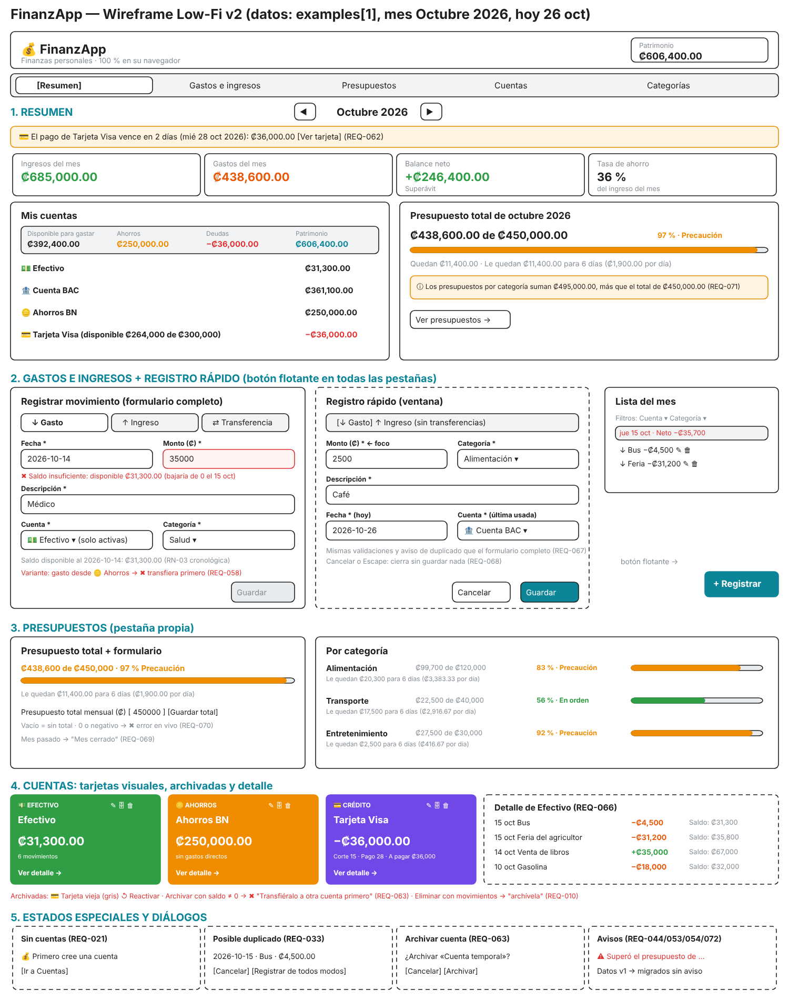

# Boceto de la UI (Wireframe) — Layout por Componentes

**Aplicación:** FinanzApp — Finanzas personales
**Entregable:** Avance 1 (Semana 2) — Wireframe Low-Fi · **actualizado a la versión 2**

> Versión gráfica editable: [`wireframe.excalidraw`](./wireframe.excalidraw) (abrir en excalidraw.com → *Open*).
> Datos de muestra: `examples[1]` de [`data-contract.json`](./data-contract.json), mes seleccionado **Octubre 2026**, hoy = 26 de octubre.



> La imagen corresponde a la v2. Los cambios de la v3 a la v6 (programaciones, ahorro en el presupuesto y metas) se describen en §2.

## 1. Layout general

```text
+----------------------------------------------------------------------------------+
| 💰 FinanzApp · Finanzas personales                      Patrimonio ₡606,400.00   |
| [Resumen] [Gastos e ingresos] [Presupuestos] [Cuentas] [Categorías]              |
+----------------------------------------------------------------------------------+
| 1. RESUMEN                       ◀  Octubre 2026  ▶                              |
|  💳 El pago de Tarjeta Visa vence en 2 días (28 oct): ₡36,000.00  [Ver tarjeta]  |
|  Ingresos ₡685,000 | Gastos ₡438,600 | Balance neto +₡246,400 | Ahorro 36 %       |
|  +-- Mis cuentas --------------------+  +-- Presupuesto total de octubre ------+  |
|  | Disponible ₡392,400 · Ahorros     |  | ₡438,600 de ₡450,000  97 % Precaución|  |
|  | ₡250,000 · Deudas −₡36,000        |  | [███████████████████▌]                |  |
|  | 💵 Efectivo          ₡31,300.00   |  | Le quedan ₡11,400 para 6 días         |  |
|  | 🏦 Cuenta BAC       ₡361,100.00   |  | ⓘ Las categorías suman ₡495,000       |  |
|  | 🪙 Ahorros BN       ₡250,000.00   |  | [Ver presupuestos →]                  |  |
|  | 💳 Tarjeta Visa     −₡36,000.00   |  +---------------------------------------+  |
|  +-----------------------------------+                                           |
+----------------------------------------------------------------------------------+
| 2. GASTOS E INGRESOS                                                             |
|  Formulario completo (gasto / ingreso / transferencia) + lista del mes por día   |
|  REGISTRO RÁPIDO (ventana desde el botón flotante [+ Registrar]):                |
|   [↓Gasto][↑Ingreso]  Monto* [2500]  Categoría* [Alimentación▾]                  |
|   Descripción* [Café]  Fecha* [hoy]  Cuenta* [última usada▾]  [Cancelar][Guardar]|
+----------------------------------------------------------------------------------+
| 3. PRESUPUESTOS: total del mes + formulario del total · por categoría con        |
|    "Le quedan ₡X para N días (₡Y por día)" o "Mes cerrado"                       |
+----------------------------------------------------------------------------------+
| 4. CUENTAS: tarjetas visuales por tipo (✎ editar · 🗄 archivar · 🗑 eliminar)      |
|    sección Archivadas (↺ reactivar) · Detalle: saldo después de cada movimiento  |
+----------------------------------------------------------------------------------+
| 5. CATEGORÍAS: formulario (nombre, tipo, presupuesto mensual) + listas por tipo  |
+----------------------------------------------------------------------------------+
| ESTADOS ESPECIALES: Sin cuentas · Duplicado · Reasignar categoría · Archivar     |
|                     · Avisos de presupuesto, datos dañados y fallo al guardar    |
+----------------------------------------------------------------------------------+
                                                              [ + Registrar ] ← flotante
```

## 2. Descripción por componentes y comportamiento guiado por intención

**Encabezado, navegación y botón flotante**
- Marca y **Patrimonio** = Disponible + Ahorros − Deudas (REQ-007, REQ-059).
- Cinco pestañas: **Resumen**, **Gastos e ingresos** (antes "Movimientos"), **Presupuestos**, **Cuentas** y **Categorías**.
- Botón flotante **"+ Registrar"** en todas las pestañas mientras exista una cuenta activa (REQ-067).

**1. Resumen**
- Selector de mes: al abrir, el mes actual (REQ-038).
- **Aviso de pago de tarjeta** si faltan 7 días o menos, o si ya venció (REQ-062).
- Tarjetas: Ingresos, Gastos, Balance neto (con "Déficit" si es negativo) y Tasa de ahorro ("—" sin ingresos) (REQ-039, REQ-040, REQ-046).
- **Mis cuentas**: desglose Disponible para gastar / Ahorros / Deudas / Patrimonio (REQ-059) y lista de cuentas activas; al tocar una se abre su detalle.
- **Presupuesto total del mes** con estado, cuánto queda por día y la advertencia si las categorías suman más que el total (REQ-070, REQ-071).

**2. Gastos e ingresos**
- **Formulario completo**: Tipo (gasto, ingreso, transferencia), Fecha, Monto, Descripción, Cuenta (solo activas) y Categoría o Cuenta destino.
  - Bajo la cuenta se ve el **saldo disponible a la fecha elegida**: es el mínimo desde esa fecha en adelante, porque el saldo no puede bajar de cero en ningún momento (RN-03).
  - Ejemplo del wireframe: ₡35,000 desde Efectivo el 14 de octubre → "Saldo insuficiente: disponible ₡31,300.00".
  - Un gasto desde una cuenta de **ahorros** se rechaza: primero hay que transferir (REQ-058).
- **Registro rápido** (ventana): solo gasto o ingreso; Monto (con el foco), Categoría y Descripción; Fecha = hoy y Cuenta = la última usada, ambas editables. Mismas validaciones y aviso de duplicado. Cancelar o Escape no guarda nada (REQ-067, REQ-068).
- **Lista del mes** agrupada por fecha con el Neto del Día, filtros por cuenta y categoría, ✎ y 🗑 (REQ-034..REQ-037).

**3. Presupuestos**
- **Total del mes**: gastado de total, barra, estado y "Le quedan ₡X para N días (₡Y por día)"; formulario para definir o quitar el total (REQ-070).
- **Por categoría**: barra, porcentaje, estado con texto y lo que queda por día; "Sin presupuesto" si no tiene; "Mes cerrado" en meses pasados (REQ-041, REQ-043, REQ-069).

**4. Cuentas**
- **Formulario**: nombre; tipo (Efectivo, Débito, Ahorros, Crédito); saldo inicial, o bien límite, **día de corte** y **día de pago** (1–28) para crédito (REQ-001, REQ-060). El tipo se bloquea si la cuenta tiene movimientos (REQ-008).
- **Tarjetas visuales** con color por tipo. La tarjeta de crédito muestra el último corte, la fecha de pago y el **pago del periodo** (REQ-061).
- 🗄 **Archivar** solo con saldo 0 (REQ-063). Las archivadas pasan a la sección "Archivadas" en gris, con ↺ Reactivar (REQ-064, REQ-065).
- **Detalle de cuenta**: todos sus movimientos con el **saldo después de cada uno** (REQ-066).

**5. Categorías**
- Alta y edición: nombre, tipo y presupuesto mensual (solo gasto). "Otros gastos" y "Otros ingresos" son del sistema (REQ-012..REQ-019).

**Estados especiales y diálogos**
- Sin cuentas → "Primero cree una cuenta" (REQ-021).
- Posible duplicado → confirmación; Cancelar conserva el formulario o el registro rápido (REQ-033).
- Eliminar categoría con movimientos → reasignación (REQ-017).
- Archivar cuenta → confirmación (REQ-063).
- Avisos: presupuesto (por categoría o total) superado (REQ-044, REQ-070), datos dañados (REQ-053), fallo al guardar (REQ-054). Los datos de la versión 1 se migran sin aviso (REQ-072).

**Programaciones (v4, reemplaza a la v3)**
- Casilla **🗓 Programar** en el formulario y en el registro rápido: frecuencia (Una vez · Cada mes · Quincenal = 15 y último), *Hasta* opcional y modo (⚡ Auto-débito · ✋ Confirmar), con la vista previa de las próximas 3 fechas y "≈ ₡X al mes" en quincenal (REQ-079, REQ-080).
- Cada mes muestra sus ocurrencias con "🗓 Programado · Auto-débito · en N días" o "⏳ Pendiente de confirmar" (REQ-081); el Resumen agrega *Pendientes de confirmar* (✓ Confirmar · ✎ Ajustar · ⏭ Omitir), *Próximos programados* y avisos de proyección (REQ-083, REQ-087).
- *Gastos e ingresos* agrega la lista **Pagos e ingresos programados** (REQ-089); las cuentas muestran "Proyectado a fin de mes" (REQ-088).

**Ahorro en el presupuesto y metas (v6)**
- La tarjeta **Presupuesto total** muestra una barra de dos tramos: gastos (color de estado) y **🪙 Apartado a ahorros** (rayado dorado), con su leyenda (REQ-070, REQ-092).
- El formulario de una cuenta de **ahorros** agrega *🎯 Meta de ahorro* y *Razón del ahorro*, ambos opcionales (REQ-093).
- La tarjeta y el detalle de la cuenta de ahorros muestran "🎯 <razón>", la barra de progreso, "₡X de ₡Y · N %", "Le faltan ₡Z" y, si hay transferencias programadas, "la alcanza en N meses (<mes año>)"; al llegar: "✓ ¡Meta alcanzada!" (REQ-094, REQ-095).
- La pestaña **Presupuestos** agrega la sección **Metas de ahorro** bajo el presupuesto total.
- *(v6.2)* La tarjeta **Próximos programados** del Resumen sigue al mes seleccionado (en un mes futuro: "Programados del 1 nov al 7 nov") y tiene **◀ 7 días antes · 7 días después ▶** (REQ-096).

**Movimientos programados (v3, reemplazada)**
- Un movimiento con fecha futura (hasta un año) se muestra con la etiqueta **"🗓 Programado · en N días"** y fondo rayado (REQ-073).
- Las cuentas muestran **Saldo actual** y, si aplica, **Después de programados** (REQ-074). El formulario indica cuánto dinero se aparta (REQ-075).
- El Resumen agrega "Incluye ₡X programados" en Ingresos y Gastos (REQ-076) y la tarjeta **Próximos programados (7 días)** (REQ-077).

**Persistencia**
- Todo el estado (`schemaVersion`, `accounts`, `categories`, `transactions`, `settings`) se guarda en `localStorage` en cada cambio y se restaura al iniciar (REQ-051, REQ-052). Sin servidores ni internet (REQ-047).
